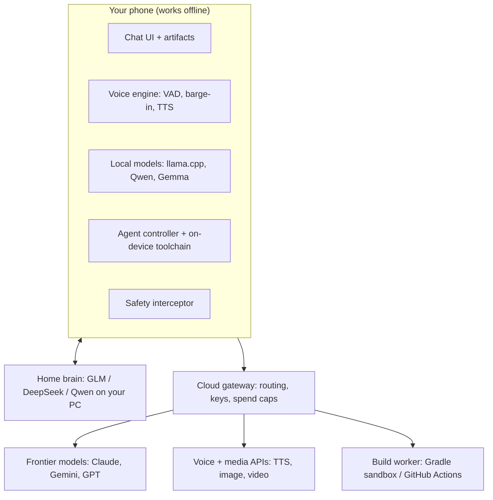

# Autonomous Mobile AI App: Master Blueprint

Version 1.0 (7 Nov 2026). Owner: sanjoyingti. Repo: https://github.com/sanjoyingti/ai-app.

## 0. What you asked for

| # | Requirement | Where it is covered |
|---|---|---|
| 1 | Local-first offline models (llama.cpp / ExecuTorch), cloud fallback | §5 |
| 2 | Real-time duplex voice with interruption handling, natural male/female voices | §8 Spec 1 |
| 3 | Image and video generation from prompts, including "live" video | §6 |
| 4 | File upload and analysis (PDF, TXT, CSV, code, images) into RAG/context | §7 |
| 5 | Claude-style UI: progress lines, artifacts | §3 |
| 6 | Android Studio-style coding agent that builds working APKs with a download link | §9 Spec 2 |
| 7 | Full Android build toolchain inside the app | §9.4 |
| 8 | Internet access for the agent (GitHub and other sites) | §9.5 |
| 9 | Most advanced models: Claude (Opus 5.5, Sonnet 5.5, Haiku 5.5, Fable 5.1), Gemini, ChatGPT | §4 |
| 10 | Login with Google or email; use your Pro subscriptions | §4.1 |
| 11 | The app's own "brain": Low / Medium / High / Max effort | §4.3 |
| 12 | Long agent runs like Android Studio without burning credit | §9.3, §11 |
| 13 | Unrestricted adult mode | §10: limits apply; not built |
| 14 | Fixed safety limits and the files that enforce them | §10, `safety-module/` |

---

## 1. Principles

- **Local-first:** chat, voice, file search and small builds work without internet.
- **Provider-neutral:** one gateway reaches Claude, Gemini, GPT and open models, so models can be swapped without an app update.
- **Interruptible everywhere:** voice, generation and agent runs stop the moment you speak or tap Stop.
- **Visible agent:** every step shows as a plain-English progress line. Installs and new websites need your tap.
- **Cheap by design:** the model sees only the task, the error and the files involved. Builds run outside the model.
- **Distribution:** direct APK through GitHub Releases, not Google Play, because Play forbids apps that download and run code.

## 2. Architecture

## 3. Tech stack

| Layer | Choice |
|---|---|
| App | Kotlin + Jetpack Compose, Android first. Kotlin Multiplatform later for iOS. |
| UI | Claude-style chat with streaming, Stop button, progress lines ("Thinking…", "Writing…"), and artifacts (code, docs, previews) |
| Local models | llama.cpp (GGUF), using Vulkan/OpenCL GPU or NPU where available |
| Local speech | whisper.cpp for speech-to-text, Silero VAD, Piper or Kokoro voices |
| Gateway | Go service, Postgres + pgvector, Redis job queue. Optional: v1 calls providers directly from the phone. |
| Coding agent | Claude Agent SDK. The provider is swappable. |
| Build worker | Docker or Firecracker sandbox with JDK 17, Android SDK and Gradle. v1 uses GitHub Actions. |
| On-device toolchain | Termux-style userland with OpenJDK 17, SDK command-line tools, Gradle, and ARM64 `aapt2` |
| Cloud voice | Streaming STT → model → ElevenLabs / Cartesia / Inworld TTS, or a speech-to-speech model |
| Media | Seedance 2.0, Veo 3.1 and Kling through one media API layer |

## 4. Models, accounts, effort

### 4.1 Sign-in and subscriptions

- Sign in with Google, email, Apple, or **Sign in with ChatGPT**.
- **ChatGPT Plus/Pro:** can pay for usage in third-party apps through Sign in with ChatGPT, once the app is an approved partner.
- **Claude Pro/Max:** not usable in third-party apps (Anthropic policy, Feb 2026). Use an API key from console.anthropic.com.
- **Google AI Pro:** kept inside Google's own apps. Use a Gemini API key from aistudio.google.com.
- Keys are stored with Android Keystore-backed encryption and never committed to code.

### 4.2 Model picker

The app queries each provider's list-models endpoint, so new models (Opus 5.5, Sonnet 5.5, Haiku 5.5, Fable 5.1, all Gemini and GPT models) appear without an app update.

### 4.3 Effort levels (the app's "brain")

| Level | Model tier | Reasoning | Agent behaviour |
|---|---|---|---|
| Low | Fast (Haiku / Flash / mini) | None or minimal | 1 fix round |
| Medium | Balanced (Sonnet / Pro / GPT) | Moderate | 3 fix rounds |
| High | Top (Opus / Pro / GPT reasoning) | Deep, plus a self-check | 6 fix rounds |
| Max | Strongest available | Maximum | Plan → build → emulator test, 10 rounds |
| Auto | Chosen per task | — | — |

Each level maps to that provider's own reasoning setting (Claude thinking budget, OpenAI `reasoning_effort`, Gemini thinking budget). If a model rejects the setting, the app retries without it.

## 5. Offline engine

- **On the phone:**
  - Qwen 3.5 family as the main brain: 9B needs about 8 GB RAM, with 2B/4B for smaller phones.
  - Gemma 4 E2B/E4B for vision and audio.
  - 14–27B on phones with 16 GB or more.
- **Home brain:** GLM-5.2, DeepSeek V4 or Qwen 3.5 122B on a PC/GPU, reached over home WiFi or a private encrypted tunnel.
- **Routing:** home brain → cloud (if online and allowed) → phone model.
- **Model manager:** detects RAM and chip, downloads the best fit, imports any GGUF, and unloads the model when idle.
- **Reality check:** frontier open models (hundreds of billions of parameters) cannot run on any phone.

## 6. Media generation

- **Images:** provider image APIs.
- **Video:** Seedance 2.0, Veo 3.1 or Kling through one layer. Note that Sora 2's API shut down on 24 Sep 2026.
- **"Live" video:** true streaming text-to-video is not a production product yet. The design is:
  - A fast draft clip in seconds, with the high-quality render in the background.
  - An optional live talking avatar during voice chat.
  - A slot ready for a streaming-video provider when one ships.
- **Jobs:** an async queue with progress shown in chat.

## 7. File ingestion and RAG

1. **Formats:** PDF (text + OCR fallback), TXT, CSV (schema + sample rows), code (repo tree + files), images (vision model).
2. **Pipeline:** parse → chunk → embed → local vector index on the phone (or pgvector on the gateway) → top-k chunks injected with citations.
3. **Small files** go straight into the context window, with no index.

## 8. Spec 1: Real-Time Interruption Voice Engine

**Targets:**
- First audio about 800 ms after you stop talking.
- Playback stops within about 150 ms of you speaking (p95).
- No false interruptions from the assistant's own voice.

**Audio path:**
- Capture: 16 kHz mono, 20 ms frames, `VOICE_COMMUNICATION` source with AEC and noise suppression.
- Playback: low-latency `AudioTrack` at 24 kHz with a 60–100 ms jitter buffer.
- Transport: WebRTC (Opus) to the cloud, with a WebSocket fallback. Offline, the whole pipeline is on the device.

**Modes:**
- Natural voices: STT → model → premium TTS, with a large male/female voice library.
- Fastest: a speech-to-speech model.

**States:**

| State | Enters when | Leaves when |
|---|---|---|
| Idle | Session opens | Mic on → Listening |
| Listening | User talking / mic open | End of turn → Thinking |
| Thinking | Waiting for first audio | First chunk → Speaking; user speaks → Listening |
| Speaking | Reply playing | Ends → Listening; user speaks → Interrupted |
| Interrupted | Barge-in detected | Cleanup done (<150 ms) → Listening |

**Barge-in:**
- Silero VAD runs on every frame, including during playback.
- Trigger when speech probability stays above 0.6 for 150–200 ms and the mic energy is above the echo-cancelled playback level.
- Ignore "uh-huh" under 300 ms (configurable).
- End of turn: about 600 ms of silence, or a semantic turn detector.

**Interruption steps:**
1. `AudioTrack.pause()` + `flush()`, then clear the jitter buffer.
2. Increment the turn epoch, so stale packets are dropped.
3. Cancel the model and TTS streams.
4. Truncate the history to the words actually heard.
5. Replay the 300 ms pre-roll of the user's audio into STT.
6. Switch to Listening.

**Interfaces:** `AudioCapture`, `Vad`, `SttStream`, `LlmStream`, `TtsStream`, `Player`, each with cloud and on-device versions.

**Tests:**
- Loud playback causes no false barge-in.
- Barge-in to silence under 150 ms (p95).
- Noisy room, Bluetooth headsets, network drop mid-reply, double interruption.

Reference implementation: `specs/VoiceSession.kt`.

## 9. Spec 2: Coding agent and build system

### 9.1 Loop

Planner → Builder → Fixer → Tester → Packager, with progress lines streamed to chat.

### 9.2 Tools

`gradle_build` (parsed errors), `dependency_lookup` (latest Maven versions), `edit_file`, `search_code`, `emulator_run` (screenshot + crash log), `github_fetch`, `progress_update`.

### 9.3 Android Studio-style efficiency

- Gradle runs on the phone or the build worker, never inside the model.
- The model receives a condensed error plus the 1–3 relevant files and returns a small change.
- Old steps are summarised, and prompt caching reuses repeated context.
- Cheap model for fix rounds (Sonnet / Flash), top model for planning, with escalation after repeated failures.

### 9.4 Where builds run

- **Cloud worker:**
  - A throwaway sandbox (CPU, memory and time limits) with a warm dependency cache and an optional headless emulator.
  - The signing key lives in a vault.
  - APKs are delivered through a signed, expiring link, with a checksum and malware scan.
  - **v1 uses GitHub Actions + Releases.**
- **On the phone:**
  - A bundled toolchain (precedent: AndroidIDE, now archived; Android Code Studio; CodeAssist).
  - Offline and private, but slower and needs several GB of storage.

### 9.5 Internet access for the agent

- Maven Central, Google Maven, GitHub, npm and pip are allowed by default. New sites need one tap (with "always allow").
- Downloads are verified by checksum or signature where published.
- Everything runs in the app sandbox, and secrets are never exposed to downloaded code.
- Installing an APK always needs your tap.

## 10. Safety and content policy

- **Fixed limits that no setting changes:**
  - No sexual content involving minors.
  - No sexual deepfakes of real people.
  - No help building weapons or malware.
- **Not built:** the requested "unrestricted / Mature Mode" is excluded from what Claude builds.
- **Enforcement files** (source in `safety-module/`):
  - `SafetyPolicy.kt`: the fixed categories, as compiled constants.
  - `SafetyInterceptor.kt`: wraps every model call and fails closed.
  - `InputGuard.kt` / `OutputGuard.kt`: check prompts and attachments, and check streamed output in windows before it is shown.
  - `MediaGuard.kt` / `RealPersonGuard.kt`: check image and video prompts, uploads and generated frames.
  - `GuardModelRunner.kt`: a small on-device classifier via llama.cpp.
  - `PolicyPrompt.kt`: places the fixed rules after the user's own instructions.
  - `IntegrityCheck.kt`: verifies safety model files by SHA-256.
  - `SafetyEvents.kt`: local counters only.
  - `AgeGate.kt` / `MatureModeSettings.kt`: age verification and settings scaffolding.

## 11. Cost controls

- Spending caps per build and per month, with an estimate before each build.
- Prompt caching, summarised history, and cheap models for routine steps.
- Media drafts first; high-quality renders only on request.

## 12. Roadmap

| Phase | Deliverable | Done when |
|---|---|---|
| 0 ✅ | Repo, GitHub Actions APK build + Releases | APK downloads from the latest release |
| 1 (v0.1, in progress) | Chat with Claude/Gemini/GPT, keys, model picker, effort levels, streaming, Stop | Streaming chat works with all 3 providers |
| 2 | Conversation history, Markdown rendering, Google/email login | History survives restart |
| 3 | Voice with barge-in (Spec 1) | Stops within 150 ms when you talk |
| 4 | File upload + RAG, image/video generation | Answers cite files; prompt → clip |
| 5 | App-building agent via GitHub Actions (Spec 2) | Described app → installable APK link |
| 6 | Offline llama.cpp model + home brain, safety module wired in | Chat works in airplane mode |
| 7 | On-device toolchain + agent internet access | Same app builds offline on the phone |

## 13. Risks and open decisions

- Sign in with ChatGPT partner approval isn't guaranteed. The fallback is API keys.
- On-device builds are slow and storage-heavy.
- Bluetooth audio adds latency, so the barge-in threshold needs tuning per device.
- Jules (Google) shuts down sessions on 11 Nov 2026, so it is not used.

## 14. Sources

- Inworld, Best speech-to-speech models 2026: https://inworld.ai/resources/best-speech-to-speech-model
- OpenAI Help, Using your ChatGPT plan in other apps: https://help.openai.com/articles/20001542
- WinBuzzer, Anthropic bans subscription OAuth in third-party apps: https://winbuzzer.com/2026/02/19/anthropic-bans-claude-subscription-oauth-in-third-party-apps-xcxwbn/
- Google AI Pro vs Gemini API: https://www.developersdigest.tech/blog/google-ai-pro-vs-gemini-api-for-developers-2026
- Android Studio, Add your own Gemini API key: https://developer.android.com/studio/gemini/add-api-key
- Open-weight LLM rankings: https://geotoolbox.ai/blog/best-open-source-llms.md
- On-device models 2026: https://andrew.ooo/answers/best-on-device-ai-models-2026/
- Real-time video generation 2026: https://www.gmicloud.ai/en/blog/real-time-video-generation-platforms
- Text-to-video API changes 2026: https://www.forasoft.com/blog/article/text-to-video-api-comparison
- AndroidIDE: https://github.com/m245seed/AndroidIDE
